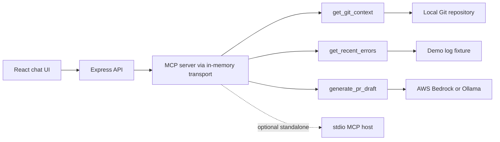

# FlowState: Agentic DevOps with MCP

FlowState is a local developer copilot that uses Model Context Protocol (MCP) tools to collect Git context and demo log entries, then drafts a Markdown pull request description with AWS Bedrock or Ollama.

## Problem

Writing a useful pull request description takes time, and a generic chat model may not know the branch, recent commits, staged files, or relevant errors in a developer's workspace.

## Solution

Ask FlowState to draft a PR. Its backend calls three MCP tools in sequence: `get_git_context`, `get_recent_errors`, and `generate_pr_draft`. Git inspection uses the current working directory; if Git is unavailable or the directory has no usable history, a clearly labeled fallback fixture is returned. The sample logs are deterministic demo data, not live terminal logs.

The HTTP app calls the same MCP server over an in-memory MCP transport. The server can also run independently over stdio for MCP hosts. Bedrock is the default LLM provider; Ollama is available for local demos. Tool execution order is intentionally deterministic so the UI can show every step consistently.

## Architecture



## Tech stack

- Node.js 18+ and TypeScript
- `@modelcontextprotocol/sdk` and Zod
- Express and CORS
- AWS Bedrock Runtime, with Ollama as a local alternative
- React 18, Tailwind CSS, Marked, and DOMPurify via CDN

## Setup

Requirements: Node.js 18+, npm, and Git. From the `flowstate/` directory:

```bash
npm install
cp .env.example .env
```

Set the provider in `.env`:

- **Bedrock:** Keep `LLM_PROVIDER=bedrock`; set `AWS_REGION` and `BEDROCK_MODEL_ID`. Credentials can come from the standard AWS credential chain (environment variables or a local AWS profile). Never commit `.env` or paste real credentials into chat.
- **Ollama:** Set `LLM_PROVIDER=ollama`, start Ollama, and make sure the model named in `OLLAMA_MODEL` is available. The default is `llama3`.

Start the app:

```bash
npm run dev
```

Open [http://localhost:3000](http://localhost:3000) and ask: `Draft a PR for my current work`.

To compile and run the production entry point:

```bash
npm run build
npm start
```

The MCP server is also available over stdio for MCP-compatible hosts:

```bash
npm run mcp
```

## MCP tools

| Tool | Purpose |
| --- | --- |
| `get_git_context` | Reads the current branch, up to three recent commits, and staged file names. Returns fixture data with `source: "fallback"` if Git commands fail. |
| `get_recent_errors` | Parses the bundled deterministic demo log fixture into error/warning entries. |
| `generate_pr_draft` | Uses the selected LLM provider and the supplied Git/log context to draft Summary, Technical Changes, and Testing Notes. |

The tool trace is returned by the API after each call completes. The mock logs are used for a deterministic demo; they are not a live log collector. The Git fallback is surfaced in the trace so mock data is not mistaken for real repository state.

## API

- `GET /api/health` returns `{ "status": "ok" }`.
- `POST /api/chat` accepts `{ "message": "Draft a PR for my current work" }` and returns the Markdown response and tool-call trace as JSON.
- `POST /api/chat/stream` accepts the same body and streams tool-start, tool-complete, and final-response events for the UI.

## Why it matters

FlowState connects an LLM to explicit, inspectable developer-context tools rather than asking it to guess from a prompt alone. Its local, deterministic flow makes the context collection visible and the PR draft easy to review before use.

## Hackathon context

This prototype was scoped for the Build, Ship, Shape: Amazon Developer Hackathon concept (including the Alexa+ track) and an open-source submission. It is an independent demo and is not affiliated with or endorsed by Amazon. GitHub PR creation, authentication, live log collection, and multi-repository support are outside the MVP.

## License

MIT. See [LICENSE](./LICENSE).
